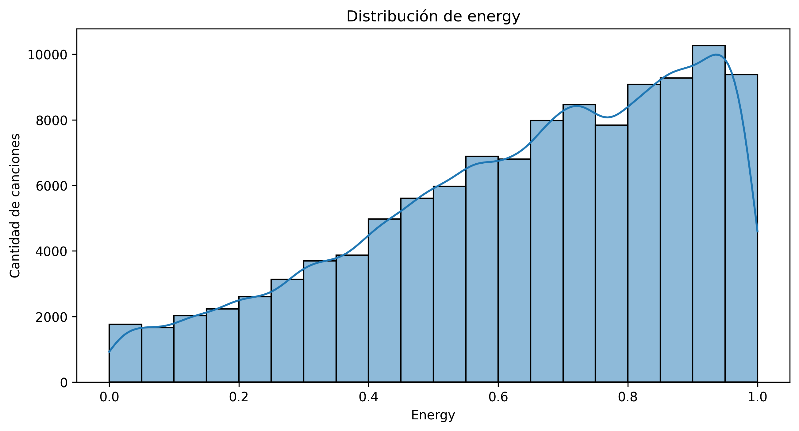
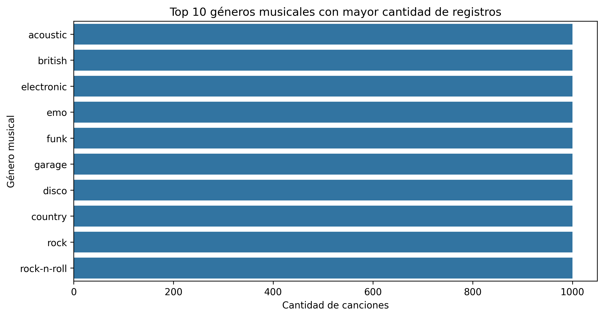

# 1. Problema de negocio

# 1. Problema de negocio

El caso seleccionado para el proyecto corresponde a la **inteligencia musical y predicción de popularidad de canciones (Spotify Tracks)**.

Las plataformas de streaming musical generan grandes volúmenes de información sobre canciones, artistas, géneros y características de audio. Estos datos pueden ser utilizados para identificar patrones asociados al nivel de popularidad de las canciones y apoyar la toma de decisiones relacionadas con el análisis y selección de contenido musical.

En este contexto, el problema de negocio consiste en analizar las características de las canciones disponibles en el dataset de Spotify para identificar patrones asociados a sus niveles de popularidad. El análisis busca generar información que sirva como base para la posterior construcción de un modelo de Machine Learning orientado a la predicción de la popularidad de las canciones.

Para abordar este problema se realizará un proceso de exploración, evaluación de calidad y preparación de los datos, considerando variables como género musical, contenido explícito, duración y características de audio.

# 2. Objetivos

## 2.1 Objetivo general

Analizar las características musicales de las canciones del dataset de Spotify para identificar patrones asociados a su nivel de popularidad y generar una base de datos preparada para el posterior desarrollo de un modelo de Machine Learning orientado a la predicción de la popularidad de las canciones.

## 2.2 Objetivos específicos

- Explorar la estructura y composición del dataset de canciones de Spotify.

- Identificar problemas de calidad de los datos, considerando valores nulos, registros duplicados y variables que requieran limpieza.

- Realizar la limpieza y preparación de los datos mediante Python, asegurando su consistencia para las etapas posteriores del proyecto.

- Analizar las principales características de las canciones, considerando variables como género musical, duración, contenido explícito, danceability y energy.

- Examinar la distribución de la variable `popularity` e identificar características relevantes para su posterior predicción.

- Generar un conjunto de datos limpio y estructurado que pueda ser utilizado como entrada para el modelo de Machine Learning.

# 3. Fuentes de datos

Para el desarrollo del proyecto se utilizó el archivo `Spotify_Tracks_Dataset.csv`, correspondiente al caso de **Inteligencia musical y predicción de popularidad de canciones (Spotify Tracks)** definido por la asignatura.

El dataset contiene información de canciones de Spotify, incluyendo datos descriptivos de las pistas, artistas, álbumes, géneros musicales y características de audio. Además, incorpora la variable `popularity`, que presenta valores entre 0 y 100 y que será utilizada como variable de interés para el posterior desarrollo del modelo de Machine Learning.

El conjunto de datos original contiene **114.000 registros y 21 variables**. Las variables incluyen diferentes tipos de información, entre ellas:

- `track_id`: identificador de la canción.
- `artists`: artista o artistas asociados.
- `album_name`: álbum al que pertenece la canción.
- `track_name`: nombre de la canción.
- `popularity`: nivel de popularidad de la canción.
- `duration_ms`: duración de la canción en milisegundos.
- `explicit`: indicador de contenido explícito.
- `danceability`: nivel de bailabilidad.
- `energy`: nivel de energía.
- `track_genre`: género musical.

### Herramientas utilizadas

Para la exploración y preparación de los datos se utilizó **Python**, principalmente mediante la biblioteca **Pandas**, permitiendo cargar, inspeccionar, limpiar y transformar el conjunto de datos.

El desarrollo y documentación del análisis se realizó mediante un **Notebook de Python**, donde se registran de forma reproducible las etapas de exploración, evaluación de calidad y preparación de los datos.

# 4. Preparación de datos y EDA

## 4.1 Exploración inicial de los datos

La exploración inicial permitió conocer la estructura, dimensiones y tipos de variables presentes en el dataset antes de realizar el proceso de limpieza.

El conjunto de datos original está compuesto por **114.000 registros y 21 variables**. Las variables presentan diferentes tipos de datos, incluyendo variables numéricas, categóricas y booleanas.

Entre las variables disponibles se encuentran información de identificación de las pistas (`track_id`), artista (`artists`), álbum (`album_name`), nombre de la canción (`track_name`), popularidad (`popularity`), características de audio y género musical (`track_genre`).

La variable `popularity` presenta valores entre 0 y 100 y se considera una variable relevante para el análisis, debido a que permite representar el nivel de popularidad de las canciones.

Durante esta etapa también se identificó la presencia de una columna denominada `Unnamed: 0`, correspondiente a un índice original del archivo. Debido a que esta columna no aporta información relevante para el análisis, fue considerada posteriormente para su eliminación durante el proceso de limpieza.

## 4.2 Calidad de los datos

### 4.2.1 Valores nulos

Se realizó una revisión de los valores nulos presentes en el conjunto de datos. El análisis identificó únicamente **3 valores nulos**, distribuidos en las variables `artists`, `album_name` y `track_name`, todos correspondientes al mismo registro.

La cantidad de valores nulos representa aproximadamente un **0,0009%** del total de registros, por lo que su presencia es mínima. Sin embargo, debido a que el registro afectado no contiene información textual fundamental de la canción, se decidió eliminar dicho registro durante el proceso de limpieza.

Como resultado, el dataset pasó de **114.000 a 113.999 registros**.

### 4.2.2 Registros duplicados

Se verificó la existencia de registros completamente duplicados mediante la función `duplicated()`. El análisis mostró que no existen registros completamente idénticos en el dataset.

Adicionalmente, se revisó la variable `track_id`, identificándose **24.259 registros que presentan un identificador repetido**. Sin embargo, estos casos no fueron eliminados, debido a que un mismo `track_id` puede aparecer asociado a diferentes valores de `track_genre`.

Por lo tanto, los registros repetidos por `track_id` no fueron considerados duplicados erróneos y se conservaron para evitar la pérdida de información.

### 4.2.3 Columna de índice

Durante la exploración se identificó la variable `Unnamed: 0`, la cual corresponde a un índice generado al guardar previamente el archivo.

Esta variable presenta una secuencia correlativa de registros y no aporta información relevante para el análisis de las canciones. Por esta razón, se decidió eliminarla durante el proceso de limpieza.

## 4.3 Proceso de limpieza de datos

A partir de los resultados obtenidos durante la evaluación de la calidad de los datos, se realizó un proceso de limpieza con el objetivo de obtener un conjunto de datos consistente y adecuado para las etapas posteriores del proyecto.

El proceso de limpieza fue implementado mediante la función `limpieza_datos()`, desarrollada en el archivo `limpieza.py`. Esta función permite aplicar de manera ordenada y reproducible las transformaciones necesarias sobre el dataset.

Las principales actividades realizadas fueron:

1. **Normalización de nombres de columnas:** se eliminaron espacios innecesarios y se estandarizaron los nombres de las variables utilizando minúsculas.

2. **Eliminación del índice original:** se eliminó la columna `Unnamed: 0`, debido a que correspondía al índice generado originalmente en el archivo y no aportaba información relevante para el análisis.

3. **Validación de las columnas requeridas:** se verificó que las variables necesarias para el análisis estuvieran presentes en el dataset.

4. **Limpieza de variables de texto:** se eliminaron espacios innecesarios en variables como `track_id`, `artists`, `album_name`, `track_name` y `track_genre`.

5. **Conversión de variables numéricas:** las variables numéricas fueron convertidas a sus tipos correspondientes para asegurar un tratamiento adecuado durante el análisis.

6. **Tratamiento de valores nulos:** se eliminó el registro que presentaba valores nulos en las variables `artists`, `album_name` y `track_name`.

7. **Eliminación de duplicados exactos:** se aplicó una revisión de registros completamente duplicados. No se identificaron duplicados exactos en el dataset original.

8. **Reinicio del índice:** finalmente, se reinició el índice del dataset limpio para mantener una numeración correlativa de los registros.

### Resultado de la limpieza

Como resultado del proceso, el dataset pasó de **114.000 registros y 21 variables** a **113.999 registros y 20 variables**. La reducción de una fila corresponde al registro que presentaba valores nulos, mientras que la reducción de una columna corresponde a la eliminación de `Unnamed: 0`.

El dataset resultante queda preparado para continuar con el análisis exploratorio de las variables relevantes.

## 4.4 Análisis exploratorio de variables relevantes

El análisis exploratorio de datos (EDA) permitió estudiar el comportamiento de las principales variables del dataset y detectar patrones relevantes antes de las etapas posteriores del proyecto.

Para esta primera etapa se seleccionaron las variables consideradas más relevantes para el problema de negocio: `popularity`, `danceability`, `energy`, `duration_ms`, `track_genre` y `explicit`.

La selección busca concentrar el análisis en variables relacionadas con la popularidad y con las principales características de las canciones, evitando incorporar variables que no aporten directamente a esta primera exploración.

### 4.4.1 Distribución de la popularidad

La variable `popularity` representa el nivel de popularidad de cada canción y presenta valores entre 0 y 100.

El análisis descriptivo muestra una media de **33,24** y una mediana de **35**. Además, se identificó una concentración importante de registros con popularidad igual a 0, correspondiente aproximadamente al **14,05%** del dataset.

El histograma permite observar que, excluyendo la concentración de valores en 0, gran parte de las canciones se encuentra en niveles de popularidad medios, mientras que los valores superiores a 80 presentan una menor frecuencia.

Esta distribución evidencia que la popularidad no se encuentra distribuida de manera uniforme y presenta una concentración importante en determinados rangos de valores.

**Figura 1.** Distribución de la popularidad de las canciones.

### 4.4.2 Distribución de danceability

La variable `danceability` representa el nivel de bailabilidad de una canción y presenta valores en un rango de 0 a 1.

A partir del análisis exploratorio se observa una concentración de los registros principalmente entre valores aproximados de 0,4 y 0,8. La mayor frecuencia se encuentra alrededor de 0,6, lo que indica que una proporción importante de las canciones presenta niveles medios y altos de bailabilidad.

No se identifican valores fuera del rango esperado para esta variable, por lo que no se considera necesario realizar una corrección asociada a sus límites.

**Figura 2.** Distribución de la variable danceability.

### 4.4.3 Distribución de energy

La variable `energy` representa el nivel de energía de una canción y presenta valores en un rango de 0 a 1.

La distribución observada muestra una mayor concentración de canciones en valores medios y altos de energía, principalmente entre 0,6 y 1,0. En contraste, las canciones con niveles bajos de energía presentan una menor frecuencia dentro del conjunto de datos.

Este comportamiento permite observar que existe una presencia importante de canciones con características de mayor intensidad dentro del dataset. No se identifican valores fuera del rango esperado para esta variable.

**Figura 3.** Distribución de la variable energy.

### 4.4.4 Distribución de la duración de las canciones

La variable `duration_ms` representa la duración de las canciones en milisegundos. Para facilitar su interpretación, durante el análisis exploratorio se realizó una conversión temporal de milisegundos a minutos.

La distribución presenta una concentración importante de canciones de duración relativamente corta, mientras que hacia valores superiores se observa una disminución progresiva de la frecuencia.

También se identifican algunos registros con duraciones considerablemente mayores que el resto. Al revisar estos casos, se encontraron canciones correspondientes a mezclas continuas, grabaciones en vivo y otros contenidos de larga duración. Por esta razón, estos valores no fueron eliminados automáticamente, ya que pueden corresponder a registros válidos dentro del catálogo musical.

En consecuencia, la variable presenta una distribución asimétrica hacia la derecha, producto de la presencia de algunas pistas con duraciones significativamente superiores a la mayoría de las observaciones.

**Figura 4.** Distribución de la duración de las canciones.

### 4.4.5 Distribución por género musical

El análisis de la variable `track_genre` permite conocer la distribución de las canciones según su género musical.

Debido a la cantidad de géneros disponibles en el dataset, se seleccionaron los 10 géneros con mayor número de registros para facilitar la visualización.

Los resultados muestran una distribución relativamente equilibrada entre los géneros con mayor representación, sin observarse una concentración extrema de registros en un único género. Esto permite contar con una representación diversa de categorías musicales dentro del conjunto de datos.

La variable `track_genre` resulta relevante para el análisis, ya que permite estudiar posteriormente si existen diferencias en los niveles de popularidad según el género musical.

**Figura 5.** Top 10 géneros musicales con mayor cantidad de registros.

### 4.4.6 Distribución del contenido explícito

La variable `explicit` indica si una canción contiene contenido explícito. Al analizar su distribución, se observa un claro predominio de canciones clasificadas como no explícitas.

Del total de registros, aproximadamente el **91,45%** corresponde a canciones sin contenido explícito (`False`), mientras que el **8,55%** corresponde a canciones clasificadas como explícitas (`True`).

Esta distribución muestra que la categoría no explícita es considerablemente más frecuente dentro del dataset. Sin embargo, ambas categorías se mantienen en el conjunto de datos, ya que la variable puede resultar relevante para analizar posteriormente su relación con la popularidad de las canciones.

**Figura 6.** Distribución de canciones según contenido explícito.

### 4.4.7 Identificación de anomalías y observaciones relevantes

Durante el análisis exploratorio se identificaron algunos valores que requieren consideración antes de utilizar los datos en las etapas posteriores del proyecto.

En primer lugar, se encontraron **157 registros con un valor de `tempo` igual a 0**, equivalente aproximadamente al 0,14% del dataset. Este valor puede corresponder a información no detectada o no disponible para determinadas canciones. Debido a su baja frecuencia y a que no se cuenta con información suficiente para determinar un valor correcto, estos registros fueron conservados.

También se identificaron canciones con **duraciones considerablemente superiores al promedio**. Al revisar estos registros se encontraron contenidos como mezclas continuas, grabaciones en vivo y sonidos de larga duración. Por esta razón, estos valores no fueron considerados errores automáticamente y se mantuvieron en el dataset.

Respecto de la variable `time_signature`, se observaron valores de 0, 1, 3, 4 y 5. La mayor concentración corresponde al valor 4, con 101.843 registros. Los valores menos frecuentes no fueron eliminados, debido a que su baja frecuencia por sí sola no permite determinar que correspondan a errores.

Por otra parte, la variable `popularity` presenta **16.020 registros con valor 0**, equivalentes aproximadamente al 14,05% de las observaciones. Estos valores se conservaron, ya que corresponden a valores posibles dentro de la escala de popularidad definida para el dataset y no existe evidencia suficiente para considerarlos registros erróneos.

En consecuencia, las anomalías y valores poco frecuentes identificados fueron evaluados individualmente. Se evitó eliminar registros únicamente por presentar valores extremos o poco frecuentes, priorizando la conservación de información válida para las etapas posteriores del proyecto.

