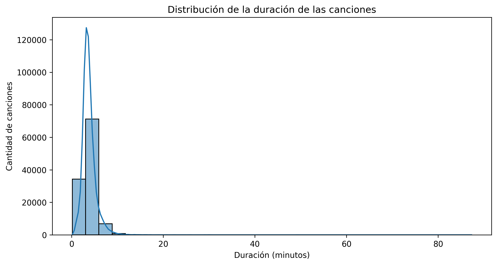
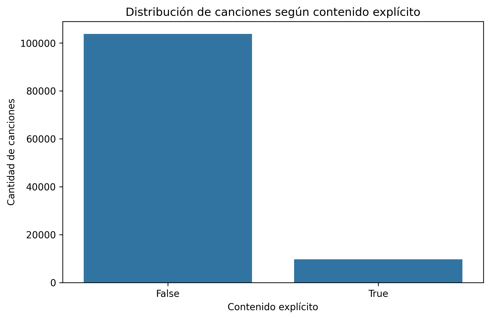
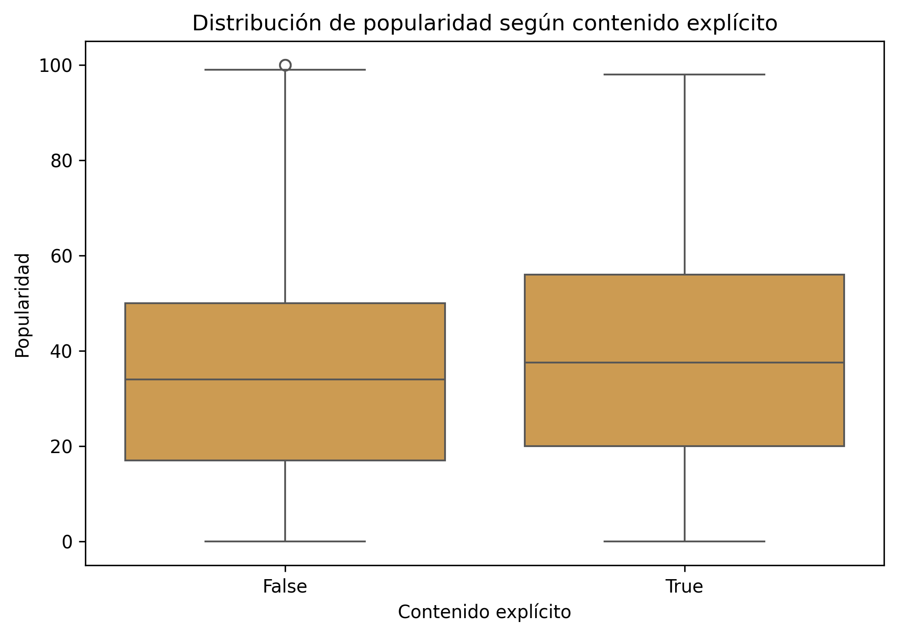
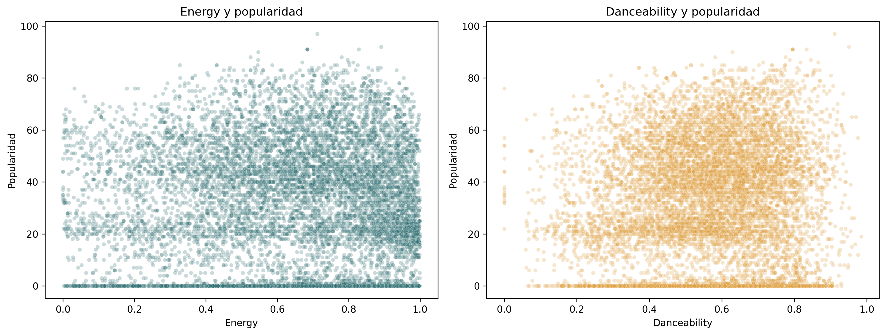
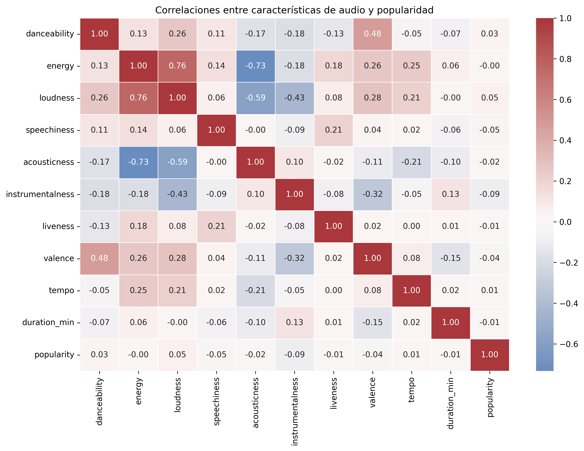

# 1. Problema de negocio
El caso seleccionado para el proyecto corresponde a la **inteligencia musical y predicción de popularidad de canciones (Spotify Tracks)**.

Las plataformas de streaming musical generan grandes volúmenes de información sobre canciones, artistas, géneros y características de audio. Estos datos pueden ser utilizados para identificar patrones asociados al nivel de popularidad de las canciones y apoyar la toma de decisiones relacionadas con el análisis y selección de contenido musical.

En este contexto, el problema de negocio consiste en analizar las características de las canciones disponibles en el dataset de Spotify para identificar patrones asociados a sus niveles de popularidad. El análisis busca generar información para entrenar y evaluar modelos de Machine Learning que permitan estimar la popularidad, clasificar las canciones en niveles de popularidad y explorar perfiles musicales mediante segmentación.

Para abordar este problema se realizó un proceso de exploración, evaluación de calidad y preparación de los datos, seguido del entrenamiento, evaluación y optimización de modelos supervisados y no supervisados. Se consideran variables como género musical, contenido explícito, duración y características de audio.

# 2. Objetivos
## 2.1 Objetivo general
Analizar las características musicales de las canciones del dataset Spotify Tracks mediante técnicas de exploración, regresión, clasificación y clustering, con el fin de identificar patrones relacionados con la popularidad, comparar el desempeño de modelos de Machine Learning y describir segmentos musicales interpretables.

## 2.2 Objetivos específicos
- Explorar la estructura y composición del dataset de canciones de Spotify.

- Identificar problemas de calidad de los datos, considerando valores nulos, registros duplicados y variables que requieran limpieza.

- Realizar la limpieza y preparación de los datos mediante Python, asegurando su consistencia para las etapas posteriores del proyecto.

- Analizar las principales características de las canciones, considerando variables como género musical, duración, contenido explícito, danceability y energy.

- Examinar la distribución de la variable `popularity` e identificar características relevantes para su posterior predicción.

- Generar un conjunto de datos limpio y estructurado para el entrenamiento y evaluación de modelos.

- Entrenar y evaluar un modelo de regresión para estimar la popularidad numérica de las canciones.

- Construir un clasificador que categorice la popularidad en niveles bajo, medio y alto.

- Aplicar K-Means para identificar perfiles de canciones a partir de características de audio.

- Optimizar los modelos mediante búsqueda de hiperparámetros o comparación de cantidades de clústeres, y documentar sus resultados y limitaciones.

# 3. Fuentes de datos
Para el desarrollo del proyecto se utilizó el archivo `Spotify_Tracks_Dataset.csv`, correspondiente al caso de **Inteligencia musical y predicción de popularidad de canciones (Spotify Tracks)** definido por la asignatura.

El dataset contiene información de canciones de Spotify, incluyendo datos descriptivos de las pistas, artistas, álbumes, géneros musicales y características de audio. Además, incorpora la variable `popularity`, que presenta valores entre 0 y 100 y se utiliza como variable objetivo en la regresión y como base para derivar las clases de popularidad del clasificador.

El conjunto de datos original contiene **114.000 registros y 21 variables**. Tras retirar el índice original, tratar el registro incompleto y eliminar duplicados exactos, el archivo limpio quedó con **113.549 registros y 20 variables**. Las variables incluyen diferentes tipos de información, entre ellas:

- `track_id`: identificador de la canción.

- `artists`: artista o artistas asociados.

- `album_name`: álbum al que pertenece la canción.

- `track_name`: nombre de la canción.

- `popularity`: nivel de popularidad de la canción.

- `duration_ms`: duración de la canción en milisegundos.

- `explicit`: indicador de contenido explícito.

- `danceability`: nivel de bailabilidad.

- `energy`: nivel de energía.

- `track_genre`: género musical.

### Herramientas utilizadas
Para la exploración y preparación de los datos se utilizó **Python**, principalmente mediante la biblioteca **Pandas**, permitiendo cargar, inspeccionar, limpiar y transformar el conjunto de datos.

La exploración inicial se documentó en un Notebook de Python y el entrenamiento, evaluación y optimización se organizaron en scripts dentro de `src/`.

# 4. Preparación de datos y EDA
## 4.1 Exploración inicial de los datos
La exploración inicial permitió conocer la estructura, dimensiones y tipos de variables presentes en el dataset antes de realizar el proceso de limpieza.

El conjunto de datos original está compuesto por **114.000 registros y 21 variables**. Las variables presentan diferentes tipos de datos, incluyendo variables numéricas, categóricas y booleanas.

Entre las variables disponibles se encuentran información de identificación de las pistas (`track_id`), artista (`artists`), álbum (`album_name`), nombre de la canción (`track_name`), popularidad (`popularity`), características de audio y género musical (`track_genre`).

La variable `popularity` presenta valores entre 0 y 100 y se considera una variable relevante para el análisis, debido a que permite representar el nivel de popularidad de las canciones.

Durante esta etapa también se identificó la presencia de una columna denominada `Unnamed: 0`, correspondiente a un índice original del archivo. Debido a que esta columna no aporta información relevante para el análisis, fue considerada posteriormente para su eliminación durante el proceso de limpieza.

## 4.2 Calidad de los datos
### 4.2.1 Valores nulos
Se realizó una revisión de los valores nulos presentes en el conjunto de datos. El análisis identificó únicamente **3 valores nulos**, distribuidos en las variables `artists`, `album_name` y `track_name`, todos correspondientes al mismo registro.

La cantidad de valores nulos representa aproximadamente un **0,0009 %** del total de registros, por lo que su presencia es mínima. Sin embargo, debido a que el registro afectado no contiene información textual fundamental de la canción, se decidió eliminar dicho registro durante el proceso de limpieza.

Tras eliminar el registro con valores nulos, el conjunto quedó en 113.999 filas; posteriormente, la eliminación de 450 duplicados exactos dejó el dataset final en 113.549 registros.

### 4.2.2 Registros duplicados
Se verificó la existencia de registros completamente duplicados mediante la función `duplicated()`. La revisión definitiva del proceso de limpieza identificó **450 registros duplicados exactos**, que fueron eliminados para evitar que esas filas se contabilizaran más de una vez.

Adicionalmente, se revisó la variable `track_id`, identificándose **24.259 registros que presentan un identificador repetido**. Sin embargo, estos casos no fueron eliminados, debido a que un mismo `track_id` puede aparecer asociado a diferentes valores de `track_genre`.

Por lo tanto, los registros repetidos por `track_id` no fueron considerados duplicados erróneos y se conservaron para evitar la pérdida de información.

### 4.2.3 Columna de índice
Durante la exploración se identificó la variable `Unnamed: 0`, la cual corresponde a un índice generado al guardar previamente el archivo.

Esta variable presenta una secuencia correlativa de registros y no aporta información relevante para el análisis de las canciones. Por esta razón, se decidió eliminarla durante el proceso de limpieza.

## 4.3 Proceso de limpieza de datos
A partir de los resultados obtenidos durante la evaluación de la calidad de los datos, se realizó un proceso de limpieza con el objetivo de obtener un conjunto de datos consistente y adecuado para las etapas posteriores del proyecto.

El proceso de limpieza fue implementado mediante la función `limpieza_datos()`, desarrollada en el archivo `limpieza.py`. Esta función permite aplicar de manera ordenada y reproducible las transformaciones necesarias sobre el dataset.

Las principales actividades realizadas fueron:

1\\. **Normalización de nombres de columnas:** se eliminaron espacios innecesarios y se estandarizaron los nombres de las variables utilizando minúsculas.

2\\. **Eliminación del índice original:** se eliminó la columna `Unnamed: 0`, debido a que correspondía al índice generado originalmente en el archivo y no aportaba información relevante para el análisis.

3\\. **Validación de las columnas requeridas:** se verificó que las variables necesarias para el análisis estuvieran presentes en el dataset.

4\\. **Limpieza de variables de texto:** se eliminaron espacios innecesarios en variables como `track_id`, `artists`, `album_name`, `track_name` y `track_genre`.

5\\. **Conversión de variables numéricas:** las variables numéricas fueron convertidas a sus tipos correspondientes para asegurar un tratamiento adecuado durante el análisis.

6\\. **Tratamiento de valores nulos:** se eliminó el registro que presentaba valores nulos en las variables `artists`, `album_name` y `track_name`.

7\\. **Eliminación de duplicados exactos:** se aplicó una revisión de registros completamente duplicados. Se eliminaron 450 duplicados exactos durante la limpieza definitiva.

8\\. **Reinicio del índice:** finalmente, se reinició el índice del dataset limpio para mantener una numeración correlativa de los registros.

### Resultado de la limpieza
Como resultado del proceso, el dataset pasó de **114.000 registros y 21 variables** a **113.549 registros y 20 variables**. Se eliminó la columna `Unnamed: 0`, el registro con valores nulos en campos descriptivos y 450 filas duplicadas exactas.

El dataset resultante se utilizó en el análisis exploratorio y como base para los scripts de entrenamiento de los modelos.

## 4.4 Análisis exploratorio de variables relevantes
El análisis exploratorio de datos (EDA) permitió estudiar el comportamiento de las principales variables del dataset y detectar patrones relevantes antes de las etapas posteriores del proyecto.

Para esta primera etapa se seleccionaron las variables consideradas más relevantes para el problema de negocio: `popularity`, `danceability`, `energy`, `duration_ms`, `track_genre` y `explicit`.

La selección busca concentrar el análisis en variables relacionadas con la popularidad y con las principales características de las canciones, evitando incorporar variables que no aporten directamente a esta primera exploración.

### 4.4.1 Distribución de la popularidad
La variable `popularity` representa el nivel de popularidad de cada canción y presenta valores entre 0 y 100.

El análisis descriptivo muestra una media de **33,24** y una mediana de **35**. Además, se identificó una concentración importante de registros con popularidad igual a 0, correspondiente aproximadamente al **14,11 %** del dataset limpio (16.020 de 113.549 registros).

El histograma permite observar que, excluyendo la concentración de valores en 0, gran parte de las canciones se encuentra en niveles de popularidad medios, mientras que los valores superiores a 80 presentan una menor frecuencia.

Esta distribución evidencia que la popularidad no se encuentra distribuida de manera uniforme y presenta una concentración importante en determinados rangos de valores.


**Figura 1.** Distribución de la popularidad de las canciones.

### 4.4.2 Distribución de danceability
La variable `danceability` representa el nivel de bailabilidad de una canción y presenta valores en un rango de 0 a 1.

A partir del análisis exploratorio se observa una concentración de los registros principalmente entre valores aproximados de 0,4 y 0,8. La mayor frecuencia se encuentra alrededor de 0,6, lo que indica que una proporción importante de las canciones presenta niveles medios y altos de bailabilidad.

No se identifican valores fuera del rango esperado para esta variable, por lo que no se considera necesario realizar una corrección asociada a sus límites.


**Figura 2.** Distribución de la variable danceability.

### 4.4.3 Distribución de energy
La variable `energy` representa el nivel de energía de una canción y presenta valores en un rango de 0 a 1.

La distribución observada muestra una mayor concentración de canciones en valores medios y altos de energía, principalmente entre 0,6 y 1,0. En contraste, las canciones con niveles bajos de energía presentan una menor frecuencia dentro del conjunto de datos.

Este comportamiento permite observar que existe una presencia importante de canciones con características de mayor intensidad dentro del dataset. No se identifican valores fuera del rango esperado para esta variable.


**Figura 3.** Distribución de la variable energy.

### 4.4.4 Distribución de la duración de las canciones
La variable `duration_ms` representa la duración de las canciones en milisegundos. Para facilitar su interpretación, durante el análisis exploratorio se realizó una conversión temporal de milisegundos a minutos.

La distribución presenta una concentración importante de canciones de duración relativamente corta, mientras que hacia valores superiores se observa una disminución progresiva de la frecuencia.

También se identifican algunos registros con duraciones considerablemente mayores que el resto. Al revisar estos casos, se encontraron canciones correspondientes a mezclas continuas, grabaciones en vivo y otros contenidos de larga duración. Por esta razón, estos valores no fueron eliminados automáticamente, ya que pueden corresponder a registros válidos dentro del catálogo musical.

En consecuencia, la variable presenta una distribución asimétrica hacia la derecha, producto de la presencia de algunas pistas con duraciones significativamente superiores a la mayoría de las observaciones.



**Figura 4.** Distribución de la duración de las canciones.

### 4.4.5 Distribución por género musical
El análisis de la variable `track_genre` permite conocer la distribución de las canciones según su género musical.

Debido a la cantidad de géneros disponibles en el dataset, se seleccionaron los 10 géneros con mayor número de registros para facilitar la visualización.

Los resultados muestran una distribución relativamente equilibrada entre los géneros con mayor representación, sin observarse una concentración extrema de registros en un único género. Esto permite contar con una representación diversa de categorías musicales dentro del conjunto de datos.

La variable `track_genre` resulta relevante para el análisis, ya que permite estudiar posteriormente si existen diferencias en los niveles de popularidad según el género musical.


**Figura 5.** Top 10 géneros musicales con mayor cantidad de registros.

### 4.4.6 Distribución del contenido explícito
La variable `explicit` indica si una canción contiene contenido explícito. Al analizar su distribución, se observa un claro predominio de canciones clasificadas como no explícitas.

Del total de registros, aproximadamente el **91,45 %** corresponde a canciones sin contenido explícito (`False`), mientras que el **8,55 %** corresponde a canciones clasificadas como explícitas (`True`).

Esta distribución muestra que la categoría no explícita es considerablemente más frecuente dentro del dataset. Sin embargo, ambas categorías se mantienen en el conjunto de datos, ya que la variable puede resultar relevante para analizar posteriormente su relación con la popularidad de las canciones.



**Figura 6.** Distribución de canciones según contenido explícito.

### 4.4.7 Identificación de anomalías y observaciones relevantes
Durante el análisis exploratorio se identificaron algunos valores que requieren consideración antes de utilizar los datos en las etapas posteriores del proyecto.

En primer lugar, se encontraron **157 registros con un valor de `tempo` igual a 0**, equivalente aproximadamente al 0,14% del dataset. Este valor puede corresponder a información no detectada o no disponible para determinadas canciones. Debido a su baja frecuencia y a que no se cuenta con información suficiente para determinar un valor correcto, estos registros fueron conservados.

También se identificaron canciones con **duraciones considerablemente superiores al promedio**. Al revisar estos registros se encontraron contenidos como mezclas continuas, grabaciones en vivo y sonidos de larga duración. Por esta razón, estos valores no fueron considerados errores automáticamente y se mantuvieron en el dataset.

Respecto de la variable `time_signature`, se observaron valores de 0, 1, 3, 4 y 5. La mayor concentración corresponde al valor 4, con 101.843 registros. Los valores menos frecuentes no fueron eliminados, debido a que su baja frecuencia por sí sola no permite determinar que correspondan a errores.

Por otra parte, la variable `popularity` presenta **16.020 registros con valor 0**, equivalentes aproximadamente al 14,05% de las observaciones. Estos valores se conservaron, ya que corresponden a valores posibles dentro de la escala de popularidad definida para el dataset y no existe evidencia suficiente para considerarlos registros erróneos.

En consecuencia, las anomalías y valores poco frecuentes identificados fueron evaluados individualmente. Se evitó eliminar registros únicamente por presentar valores extremos o poco frecuentes, priorizando la conservación de información válida para las etapas posteriores del proyecto.

# 5. KPIs del proyecto
Los KPIs permiten evaluar tanto la calidad de la preparación como el desempeño de los modelos. Los indicadores de calidad describen la confiabilidad de los datos; las métricas de modelamiento evalúan cada tarea por separado y no deben compararse directamente entre tipos de modelos distintos.

\| KPI | Qué mide | Resultado / criterio | Importancia |

\|---|---|---|---|

\| Retención de registros | Proporción de registros que se conserva tras la limpieza | 113.549 de 114.000 registros originales (aprox. 99,60 %) | Controla la pérdida de información durante la preparación |

\| Completitud del dataset limpio | Presencia de valores nulos en el dataset usado | 0 valores nulos pendientes tras la limpieza | Reduce errores en entrenamiento y análisis |

\| Consistencia de popularidad | Tipo y rango de `popularity` | Variable numérica entre 0 y 100 | Asegura que la variable objetivo sea interpretable |

\| Error de regresión | Error absoluto y cuadrático medio de la predicción | MAE = 18,9311; RMSE = 22,3662 | Cuantifica el error de predicción de popularidad |

\| Capacidad explicativa de regresión | Proporción de variabilidad explicada | R² de prueba = 0,0027 | Permite identificar la limitada capacidad predictiva del modelo lineal |

\| Desempeño del clasificador | Proporción de aciertos y F1 macro | Accuracy = 57,29 %; F1 macro = 0,4757 en el modelo optimizado | Resume el rendimiento y ayuda a considerar el desbalance entre clases |

\| Calidad de segmentación | Separación y cohesión de los clústeres | Silhouette = 0,1616 para K=4; mejor valor comparado = 0,2499 para K=2 | Orienta la elección de número de grupos junto con su interpretabilidad |

Los resultados indican que el árbol de decisión optimizado mejora respecto del modelo base, mientras que la regresión lineal no alcanza una capacidad explicativa útil con los predictores empleados. En K-Means, el mejor Silhouette Score corresponde a K=2, aunque se conserva K=4 por la utilidad analítica de describir cuatro perfiles musicales.

# 6. Aplicación de CRISP-DM
## 6.1 Business Understanding
El problema de negocio es comprender qué características musicales se relacionan con la popularidad de una canción y evaluar enfoques de Machine Learning que permitan estimar la popularidad, clasificar sus niveles y descubrir segmentos musicales. El resultado es un análisis académico exploratorio que aporta evidencia cuantitativa, sin afirmar causalidad ni representar una solución desplegada en Spotify.

## 6.2 Data Understanding
Se cargó el archivo `Spotify_Tracks_Dataset.csv` y se revisaron sus dimensiones, tipos, valores nulos, duplicados, rangos y distribuciones. Se identificó `popularity` como variable objetivo y se analizaron variables de audio, contenido explícito y género musical. También se revisaron casos especiales como `tempo = 0`, duraciones extensas y popularidad igual a 0.

## 6.3 Data Preparation
La función `limpieza_datos()` normaliza los nombres de columnas, elimina el índice original, valida las columnas requeridas, limpia textos, convierte variables numéricas, elimina filas con valores nulos y elimina duplicados exactos. Para el árbol de decisión se derivó `popularity_level` a partir de `popularity`. En los pipelines supervisados, `track_genre` se codificó mediante One-Hot Encoding; para K-Means, las diez variables seleccionadas se estandarizaron mediante `StandardScaler`.

## 6.4 Modeling
En la Evaluación 2 se entrenaron tres enfoques de Machine Learning: regresión lineal para estimar `popularity` como valor numérico; árbol de decisión para clasificar las canciones en niveles de popularidad baja, media y alta; y K-Means para identificar grupos de canciones según sus características de audio. En los modelos supervisados, la variable objetivo se mantiene separada de los predictores para evitar filtraciones de información.

## 6.5 Evaluation
La evaluación incluye métricas de calidad de datos y métricas específicas de cada modelo. Para regresión se calcularon MAE, MSE, RMSE y R²; para clasificación, accuracy, precision, recall, F1 y matriz de confusión; y para K-Means, Silhouette Score, tamaños de clúster y perfiles promedio. Los resultados y sus limitaciones se detallan en la sección 9. La evaluación muestra que el árbol de decisión optimizado mejora el desempeño respecto del modelo base, la regresión conserva R² cercano a cero y K-Means presenta separación limitada entre grupos.

## 6.6 Deployment
El despliegue en producción no forma parte del trabajo realizado. Sí se guardaron los modelos entrenados y los artefactos necesarios en la carpeta `models/`, y se generaron archivos de datos y gráficos en `data/` e `images/` para facilitar la revisión y reproducibilidad local. Un despliegue como servicio batch o aplicación sería una etapa futura.

# 7. Segunda parte del EDA: relaciones y comparaciones
El EDA avanzado compara la popularidad según género, contenido explícito y características de audio. La popularidad promedio más alta entre los grupos mostrados corresponde a `pop-film`, con **59,28**, seguido por `k-pop`, con **56,96**. Estas diferencias sugieren que el género debe incorporarse como variable categórica en el análisis posterior.


**Figura 7.** Géneros con mayor popularidad promedio.

Las canciones con contenido explícito presentan una popularidad promedio de **36,52**, mientras que las canciones sin contenido explícito alcanzan **33,02**. La diferencia es descriptiva y no permite afirmar que el contenido explícito cause una mayor popularidad.



**Figura 8.** Distribución de popularidad según contenido explícito.

La matriz de correlación muestra relaciones fuertes entre algunas variables de audio entre sí, especialmente `energy` y `loudness` (**0,76**) y `energy` y `acousticness` (**-0,73**). Estas relaciones deben considerarse para evitar interpretar cada variable como completamente independiente.



**Figura 9.** Relaciones entre `energy`, `danceability` y `popularity`.



**Figura 10.** Matriz de correlación entre características de audio y popularidad.

En relación directa con `popularity`, las correlaciones lineales son débiles. La mayor asociación absoluta corresponde a `instrumentalness` (**-0,0947**), seguida por `loudness` (**0,0474**) y `speechiness` (**-0,0455**). Esto indica que la popularidad probablemente depende de combinaciones de variables, categorías y factores no incluidos en el dataset, por lo que no se debe basar la selección únicamente en correlaciones simples.

# 8. Hallazgos principales
- La popularidad está concentrada en niveles bajos y medios; las canciones con `popularity >= 75` representan **2.829 de 113.549 registros**, aproximadamente **2,49%**.

- El grupo de popularidad alta presenta mayor `danceability` promedio (**0,632**) que el resto (**0,565**) y mayor `energy` promedio (**0,679** frente a **0,641**).

- Las canciones con popularidad alta tienen una proporción de contenido explícito de **19,30%**, superior al **8,28%** observado en el resto.

- `track_genre` presenta diferencias relevantes entre grupos: `pop-film` y `k-pop` aparecen entre los géneros con mayor popularidad promedio dentro del análisis.

- Se observan relaciones importantes entre predictores, pero las asociaciones lineales individuales con `popularity` son débiles. Por ello, las conclusiones deben complementarse con modelos y análisis por grupos.

- La duración presenta una asociación prácticamente nula con la popularidad en este conjunto, con correlación **-0,0079**. Los valores extremos de duración deben conservarse mientras correspondan a contenidos válidos, pero conviene revisar su influencia durante el modelamiento.

- El dataset limpio quedó preparado para el entrenamiento. Las transformaciones se aplicaron según el modelo: codificación de género en los modelos supervisados y estandarización de variables numéricas en K-Means.

# 9. Modelamiento, evaluación y optimización
Esta sección documenta los modelos desarrollados en la Evaluación 2. Los tres enfoques responden preguntas diferentes y sus métricas no son directamente comparables entre sí: la regresión estima un valor numérico, la clasificación predice una categoría y K-Means agrupa canciones sin utilizar una etiqueta objetivo.

## 9.1 Preparación común y reproducibilidad
El dataset utilizado por los scripts es `data/Spotify_Tracks_Limpio.csv`, con 113.549 filas y 20 columnas. Los scripts se organizan bajo `src/entrenamiento/`, `src/evaluacion/` y `src/optimizacion/`. Los modelos serializados se guardan en `models/`, mientras que las visualizaciones y resultados auxiliares se guardan en `images/` y `data/`.

Para los modelos supervisados se utilizaron transformaciones de variables categóricas mediante `OneHotEncoder(handle_unknown="ignore")` y pipelines de scikit-learn. La partición de entrenamiento y prueba utiliza `test_size=0.2` y `random_state=42`, con 90.839 registros para entrenamiento y 22.710 para prueba. Para el árbol de decisión se utiliza además una partición estratificada, dado el desbalance entre los niveles de popularidad.

## 9.2 Regresión lineal: predicción de popularidad
**Objetivo.** Estimar el valor numérico de `popularity` en una escala de 0 a 100.

**Predictores.** Se utilizaron características numéricas de audio y duración (`duration_ms`, `explicit`, `danceability`, `energy`, `key`, `loudness`, `mode`, `speechiness`, `acousticness`, `instrumentalness`, `liveness`, `valence`, `tempo` y `time_signature`), junto con `track_genre` codificado mediante One-Hot Encoding.

**Evaluación del modelo base.**

\| Métrica | Resultado |

\|---|---:|

\| MAE | 18,9311 |

\| MSE | 500,2452 |

\| RMSE | 22,3662 |

\| R² en prueba | 0,0027 |

\| R² en entrenamiento | 0,0026 |

El error absoluto medio es de aproximadamente 18,93 puntos de popularidad. El R² próximo a cero indica que el modelo explica muy poca variabilidad de la popularidad a partir de los predictores utilizados. La similitud entre R² de entrenamiento y prueba no sugiere una brecha marcada de sobreajuste; el problema principal es la baja capacidad explicativa del modelo.

**Optimización.** Se compararon Ridge mediante `GridSearchCV` y Lasso mediante `RandomizedSearchCV`.

\| Método | Mejor R² en validación cruzada | R² en prueba | RMSE en prueba | Parámetro destacado |

\|---|---:|---:|---:|---|

\| Ridge + GridSearchCV | 0,0518 | 0,0027 | 22,3662 | `alpha=10` |

\| Lasso + RandomizedSearchCV | 0,0018 | 0,0020 | 22,3740 | `alpha≈2,0684` |

Ridge fue la alternativa seleccionada según el mejor R² de validación cruzada. Sin embargo, el resultado en prueba no mejoró de manera significativa frente al modelo base. Esta diferencia entre validación cruzada y prueba debe reportarse con transparencia y sugiere que la regularización, por sí sola, no resuelve la limitada relación predictiva disponible en los datos.

**Artefactos.** `models/regresion_lineal.pkl` y `models/regresion_lineal_optimizado.pkl`.

## 9.3 Árbol de decisión: clasificación de popularidad
**Objetivo.** Clasificar las canciones en tres niveles mediante la variable `popularity_level`, derivada de `popularity` con los intervalos baja (0–33), media (34–66) y alta (67–100), implementados con los cortes `[-1, 33, 66, 100]`.

**Distribución de clases.** Baja: 55.179 registros (48,59 %); media: 50.743 (44,69 %); alta: 7.627 (6,72 %). La clase alta está subrepresentada, por lo que se utilizó `class_weight="balanced"` y partición estratificada. Las características predictoras son las mismas características musicales descritas para regresión, con `track_genre` codificado.

**Modelo base.** Se utilizó `DecisionTreeClassifier(random_state=42, max_depth=4, class_weight="balanced")`.

\| Indicador | Resultado |

\|---|---:|

\| Accuracy | 0,2849 (28,49 %) |

\| F1 macro | 0,2823 |

\| F1 ponderado | 0,3288 |

El modelo base presentó un desempeño bajo y un tratamiento desigual de las clases. En particular, su precisión para la clase alta fue 0,0924, aunque su recall fue 0,7843, lo que significa que identificó una proporción importante de canciones realmente altas, pero también asignó esa clase a muchos ejemplos que no lo eran.

**Optimización.** Se compararon GridSearchCV y RandomizedSearchCV utilizando `f1_macro` como criterio de selección, para dar peso equivalente al desempeño en cada clase. La búsqueda aleatoria fue la alternativa seleccionada, con parámetros `criterion='gini'`, `max_depth=14`, `min_samples_leaf=9` y `min_samples_split=18`.

\| Indicador | Modelo base | Modelo optimizado |

\|---|---:|---:|

\| Accuracy | 28,49 % | 57,29 % |

\| F1 macro | 0,2823 | 0,4757 |

Reporte del modelo optimizado:

\| Clase | Precision | Recall | F1-score | Soporte |

\|---|---:|---:|---:|---:|

\| Alta | 0,35 | 0,28 | 0,31 | 1.525 |

\| Baja | 0,83 | 0,30 | 0,44 | 11.036 |

\| Media | 0,53 | 0,91 | 0,67 | 10.149 |

\| Macro promedio | 0,57 | 0,50 | 0,48 | 22.710 |

\| Promedio ponderado | 0,66 | 0,57 | 0,54 | 22.710 |

La optimización elevó la accuracy de 28,49 % a 57,29 % y el F1 macro de 0,2823 a 0,4757. Aun así, el recall de la clase alta es 0,28, de modo que el clasificador no identifica todas las canciones populares. El resultado global debe interpretarse junto con el desempeño por clase y no como evidencia de una solución perfecta.

**Artefactos.** `models/arbol_decision.pkl` y `models/arbol_decision_optimizado.pkl`.

## 9.4 K-Means: segmentación musical
**Objetivo.** Identificar grupos de canciones con características de audio similares, sin utilizar `popularity` como variable para formar los clústeres.

**Variables utilizadas.** `duration_ms`, `danceability`, `energy`, `loudness`, `speechiness`, `acousticness`, `instrumentalness`, `liveness`, `valence` y `tempo`. Antes del entrenamiento se aplicó `StandardScaler`, debido a que las variables están en escalas diferentes.

**Configuración final.** `KMeans(n_clusters=4, random_state=42, n_init=10)`. Se entrenó también una versión sin escalar únicamente con fines exploratorios y comparativos; esta versión no se utiliza como modelo definitivo. La segmentación final corresponde al modelo entrenado sobre las diez variables después de aplicar `StandardScaler`. El Silhouette Score de la solución de cuatro clústeres fue 0,1616, lo que indica una separación limitada entre grupos; por ello, los perfiles se deben interpretar como tendencias y no como categorías musicales perfectas.

\| Clúster | Registros | Proporción | Danceability media | Energy media | Acousticness media | Liveness media | Popularidad media |

\|---|---:|---:|---:|---:|---:|---:|---:|

\| 0 | 8.702 | 7,66 % | 0,53 | 0,75 | 0,34 | 0,73 | 34,14 |

\| 1 | 47.411 | 41,75 % | 0,69 | 0,69 | 0,25 | 0,16 | 33,49 |

\| 2 | 34.461 | 30,35 % | 0,49 | 0,80 | 0,08 | 0,19 | 34,14 |

\| 3 | 22.975 | 20,23 % | 0,46 | 0,27 | 0,78 | 0,16 | 31,46 |

**Interpretación exploratoria de los clústeres:**

- **Clúster 0:** alta energía y liveness, compatible con pistas con rasgos de interpretación en vivo.

- **Clúster 1:** mayor bailabilidad y valence relativamente alta, compatible con canciones rítmicas y positivas.

- **Clúster 2:** energía y tempo elevados, con baja acousticness y mayor instrumentalness que otros grupos.

- **Clúster 3:** baja energía y mayor acousticness, compatible con canciones acústicas o suaves.

Estos nombres son interpretaciones descriptivas de promedios de variables; no corresponden a etiquetas de género verificadas. Las medias de popularidad entre clústeres son relativamente cercanas, por lo que la segmentación no demuestra por sí sola que un perfil sea mucho más popular que otro.

**Optimización del número de clústeres.** Se compararon valores de K entre 2 y 7 mediante Silhouette Score, además del método del codo basado en la inercia.

\| K | Silhouette Score | Inercia |

\|---:|---:|---:|

\| 2 | 0,2499 | 916.631,5443 |

\| 3 | 0,1556 | 823.371,4685 |

\| 4 | 0,1616 | 754.444,3254 |

\| 5 | 0,1662 | 691.752,5114 |

\| 6 | 0,1662 | 639.591,6314 |

\| 7 | 0,1767 | 590.211,3983 |

K=2 obtuvo el mejor Silhouette Score de las alternativas evaluadas. No obstante, se mantuvo K=4 como configuración final porque permite describir cuatro perfiles diferenciados con mayor granularidad para el análisis. Esta decisión prioriza la utilidad interpretativa, no la máxima separación estadística. Si el criterio principal fuera exclusivamente maximizar Silhouette Score, K=2 sería la alternativa preferible.

**Artefactos.** `models/modelo_kmeans.pkl`, `models/scaler_kmeans.pkl`, `data/Spotify_Tracks_Clusters.csv`, `data/resultados_optimizacion_kmeans.csv`, `images/clusters_spotify.png` e `images/metodo_codo_kmeans.png`. El script `src/entrenamiento/kmeans.py` genera la segmentación final con K=4; `src/optimizacion/op_kmeans.py` compara K=2 a K=7 y genera la tabla de resultados y el gráfico del método del codo.

## 9.5 Comparación y conclusiones de modelamiento
Los resultados muestran que no existe un único modelo que resuelva todas las preguntas del proyecto. La regresión lineal no logra explicar adecuadamente la popularidad como valor continuo; el árbol optimizado mejora considerablemente la clasificación, aunque mantiene dificultades con la clase alta; y K-Means permite explorar perfiles musicales, con separación limitada y diferencias pequeñas en popularidad promedio.

Por tanto, los hallazgos deben comunicarse como resultados analíticos exploratorios, no como evidencia de causalidad ni como garantía de predicción precisa. La popularidad puede depender de factores no incluidos en las variables del dataset, como exposición, promoción, trayectoria del artista, actualidad o contexto de escucha. Estos factores son hipótesis plausibles, no variables comprobadas por este análisis.

## 9.6 Estructura del proyecto y ejecución
La estructura utilizada para organizar el proyecto es:

```text

eva1_machine_learning/

├── data/

│   ├── Spotify_Tracks_Dataset.csv

│   ├── Spotify_Tracks_Limpio.csv

│   ├── Spotify_Tracks_Clusters.csv

│   └── resultados_optimizacion_kmeans.csv

├── images/

├── models/

├── src/

│   ├── limpieza.py

│   ├── entrenamiento/

│   │   ├── regresion_lineal.py

│   │   ├── arbol_decision.py

│   │   └── kmeans.py

│   ├── evaluacion/

│   │   ├── ev_regresion_lineal.py

│   │   ├── ev_arbol_decision.py

│   │   └── ev_kmeans.py

│   └── optimizacion/

│       ├── op_regresion_lineal.py

│       ├── op_arbol_decision.py

│       └── op_kmeans.py

└── docs/

    ├── informe_tecnico.md

    └── informe_tecnico_actualizado.md

```

El proyecto utiliza Python y bibliotecas como pandas, NumPy, scikit-learn, matplotlib y joblib. Para reproducir los resultados, se debe contar con las dependencias instaladas y el archivo de datos original en `data/`. Los scripts deben ejecutarse desde el proyecto respetando el orden lógico: limpieza, entrenamiento, evaluación y optimización. Para K-Means, `src/entrenamiento/kmeans.py` entrena y guarda el modelo final con cuatro clústeres, mientras que `src/optimizacion/op_kmeans.py` evalúa distintas cantidades de clústeres sin sobrescribir el modelo definitivo ni el dataset final de clústeres. La disponibilidad exacta de versiones depende del entorno donde se ejecute el proyecto; para una reproducibilidad estricta se recomienda registrar las versiones instaladas en un archivo `requirements.txt`.
